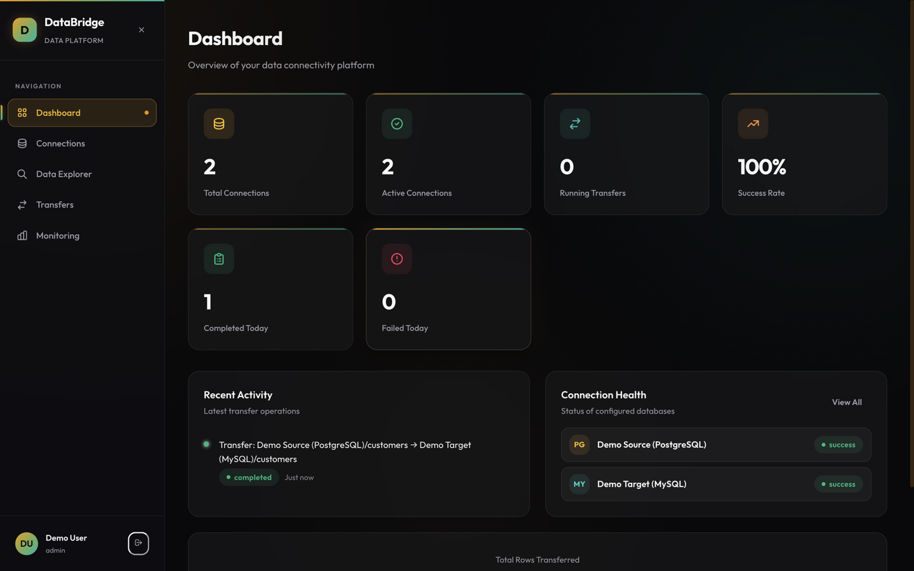
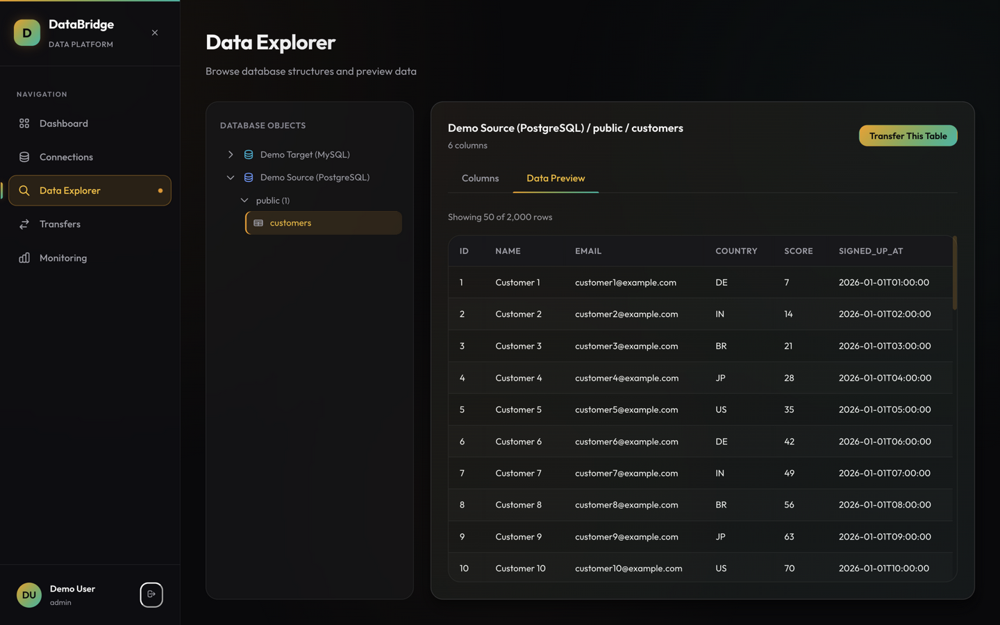
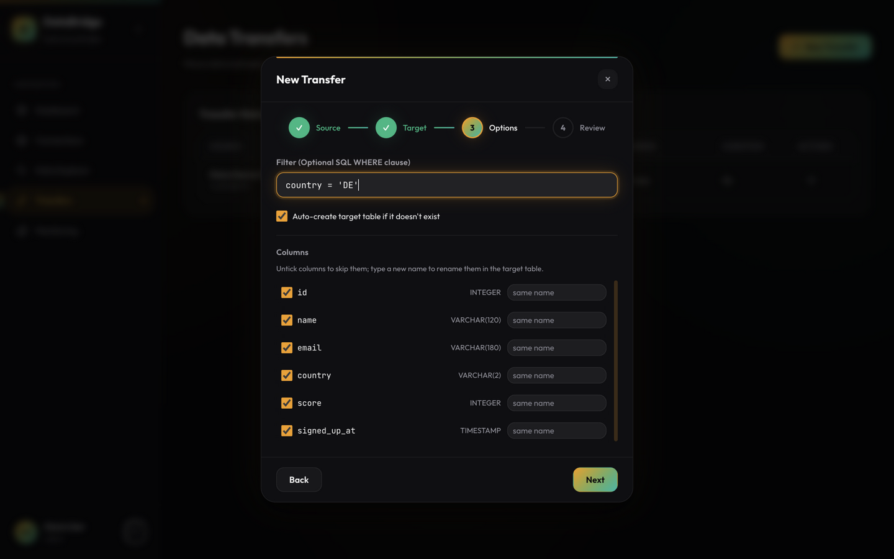
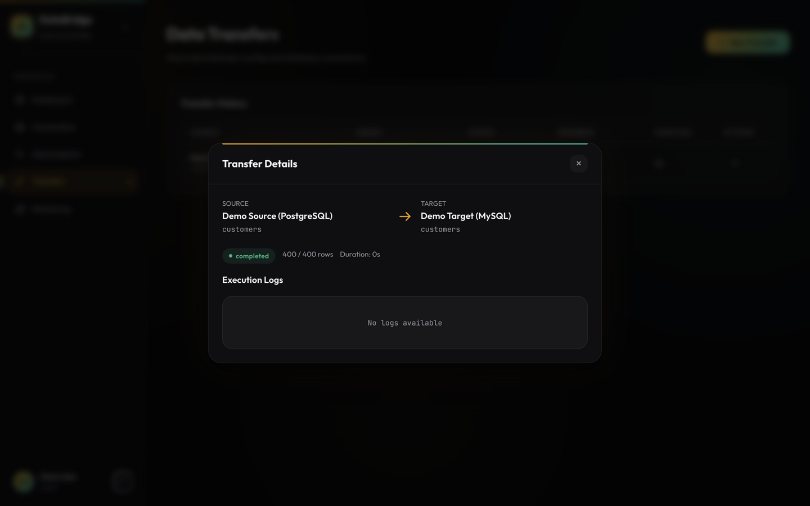
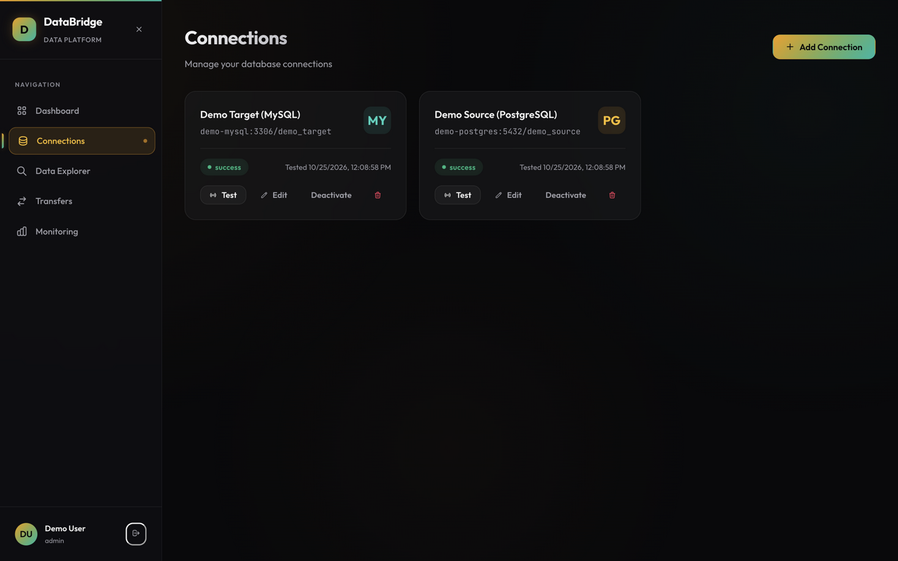
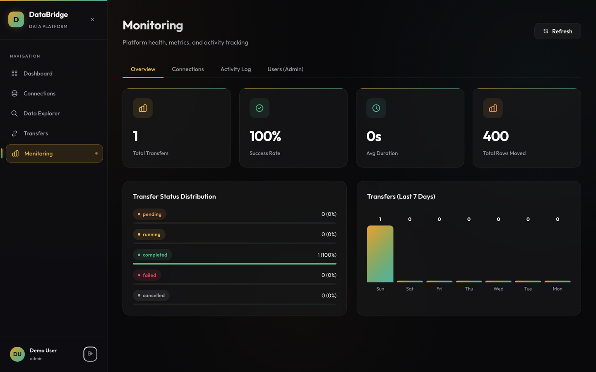
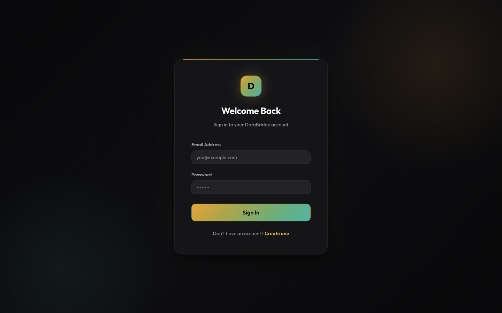
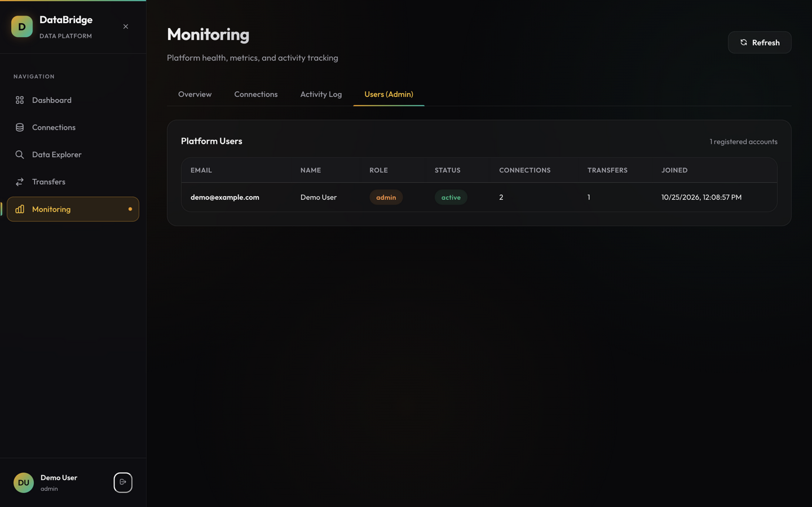
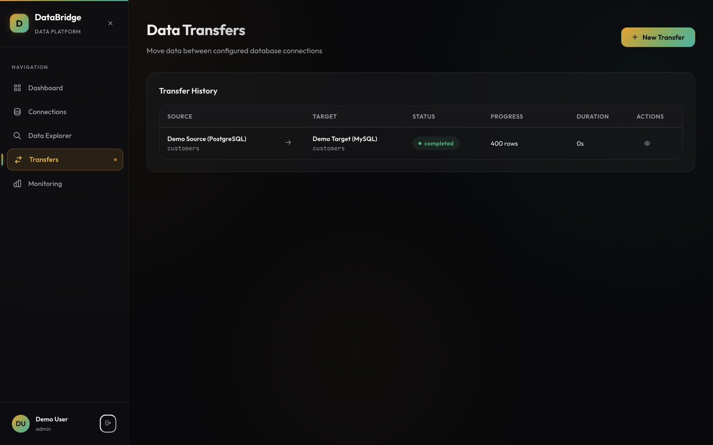

# DataBridge - Data Connectivity & Transfer Platform

<p align="center">
  <strong>A full-stack web application for connecting to multiple database systems, exploring data structures, and transferring data between sources.</strong>
</p>

---

## 🚀 Features

| Feature | Description |
|---------|-------------|
| **🔐 Secure Authentication** | JWT-based auth with bcrypt password hashing and Fernet-encrypted credential storage |
| **🔌 Connection Management** | Add, edit, test, and remove PostgreSQL & MySQL connections |
| **🔍 Data Discovery** | Explore schemas, tables, views, columns with metadata and data preview |
| **🔄 Data Transfer** | Move data between databases with progress tracking, filtering, and column mapping |
| **📊 Monitoring Dashboard** | Real-time stats, connection health, activity feed, and operational metrics |
| **⚡ Background Processing** | Celery workers for async transfer execution with Redis broker |
| **🐳 Containerized** | Full Docker Compose setup for one-command deployment |

## 📸 Screenshots

| | |
|---|---|
|  |  |
|  |  |
|  |  |

<details>
<summary>More views</summary>

| | |
|---|---|
|  |  |
|  | |
</details>

*Captured from the [demo stack](#60-second-demo-with-sample-data) after its scripted PostgreSQL → MySQL transfer.*

## 🏗️ Architecture

```
┌─────────────────┐     ┌──────────────────────────────────┐     ┌─────────────────┐
│                 │     │         Backend (FastAPI)          │     │                 │
│   React SPA     │────▶│  Auth │ Connections │ Discovery   │────▶│   PostgreSQL    │
│   (Vite)        │     │  Transfers │ Monitoring            │     │   (App DB)      │
│                 │     │                                    │     │                 │
│  Port: 5173     │     │  Port: 8000                        │     │  Port: 5432     │
└─────────────────┘     └──────────────┬───────────────────┘     └─────────────────┘
                                       │
                                       ▼
                        ┌──────────────────────────┐
                        │    Celery Workers         │
                        │    (Background Tasks)     │
                        │                          │
                        │  Redis Broker (Port 6379) │
                        └──────────────────────────┘
                                       │
                          ┌────────────┴────────────┐
                          ▼                         ▼
                   ┌──────────┐              ┌──────────┐
                   │PostgreSQL│              │  MySQL   │
                   │(User DB) │              │(User DB) │
                   └──────────┘              └──────────┘
```

## 🛠️ Tech Stack

### Backend
- **Framework**: FastAPI (Python 3.11)
- **ORM**: SQLAlchemy 2.0 (async)
- **Database**: PostgreSQL (application data)
- **Auth**: JWT (PyJWT) + bcrypt
- **Encryption**: Fernet (cryptography)
- **Background Tasks**: Celery + Redis
- **Migrations**: Alembic
- **API Docs**: Swagger UI (built-in with FastAPI)

### Frontend
- **Framework**: React 18
- **Build Tool**: Vite 6
- **Routing**: React Router v6
- **HTTP Client**: Axios (with JWT interceptors)
- **Styling**: Vanilla CSS (custom design system)
- **Notifications**: react-hot-toast
- **Icons**: react-icons

### Infrastructure
- **Containerization**: Docker & Docker Compose
- **Message Broker**: Redis 7
- **Database**: PostgreSQL 16

---

## ⚡ Quick Start

### Prerequisites
- Docker & Docker Compose installed
- Git

### 1. Clone the repository
```bash
git clone <repository-url>
cd DataBridge
```

### 2. Configure secrets
The API refuses to start with placeholder secrets, so set real values first:
```bash
cat > .env <<EOF
SECRET_KEY=$(python3 -c "import secrets; print(secrets.token_urlsafe(64))")
ENCRYPTION_KEY=$(python3 -c "from cryptography.fernet import Fernet; print(Fernet.generate_key().decode())")
POSTGRES_PASSWORD=$(python3 -c "import secrets; print(secrets.token_urlsafe(24))")
EOF
```
Docker Compose reads these variables from the environment or a `.env` file next
to `docker-compose.yml`.

### 3. Start all services with Docker Compose
```bash
docker compose up --build
```

This starts 5 services:
| Service | URL | Description |
|---------|-----|-------------|
| **Frontend** | http://localhost:5173 | React application |
| **Backend API** | http://localhost:8000 | FastAPI server |
| **API Docs** | http://localhost:8000/docs | Swagger UI |
| **PostgreSQL** | localhost:5432 | Application database |
| **Redis** | localhost:6379 | Celery broker |

### 4. Create an account
Navigate to http://localhost:5173 and register a new account.

### 5. Add your first database connection
Go to **Connections** → **Add Connection** and enter your database details.

### 60-second demo with sample data
Want to see a full transfer without provisioning anything yourself?

```bash
# add the demo overlay: a seeded PostgreSQL source and a MySQL target
docker compose -f docker-compose.yml -f docker-compose.demo.yml up -d

# register a demo user, connect both databases and run a
# PostgreSQL -> MySQL transfer through the public API
./demo/demo_transfer.sh
```

Then sign in at http://localhost:5173 (`demo@example.com` /
`demo-password-123`) to explore the data and watch the transfer history —
the script also promotes that account to **admin**, so the Monitoring →
Users tab is unlocked. To grant admin to any other account:

```bash
docker compose exec backend python -m scripts.promote_admin someone@example.com
```

---

## 📁 Manual Setup (Without Docker)

### Backend

```bash
cd backend

# Create virtual environment
python -m venv venv
source venv/bin/activate  # macOS/Linux
# or: venv\Scripts\activate  # Windows

# Install dependencies (runtime + dev tooling)
pip install -r requirements-dev.txt

# Configure environment
cp .env.example .env
# Edit .env with your database credentials

# Apply database migrations
alembic upgrade head

# Start the API server
uvicorn app.main:app --host 0.0.0.0 --port 8000 --reload

# Start Celery worker + beat (separate terminals)
celery -A app.workers.celery_app worker --loglevel=info
celery -A app.workers.celery_app beat --loglevel=info
```

### Frontend

```bash
cd frontend

# Install dependencies
npm ci

# Start dev server
npm run dev
```

### Tests and quality gates

```bash
# Backend: 82 tests incl. the end-to-end transfer engine, with a
# coverage gate (>= 70%), plus ruff and mypy
cd backend
python -m pytest
ruff check . && ruff format --check .
mypy app

# Frontend: Vitest + React Testing Library, ESLint and Prettier
cd frontend
npm test
npm run lint && npm run format:check
```

See [docs/TESTING.md](docs/TESTING.md) for what each suite covers.

---

## 📚 Documentation

| Document | Description |
|----------|-------------|
| [Architecture](docs/ARCHITECTURE.md) | System design, component architecture, and design decisions |
| [API Reference](docs/API.md) | Complete REST API documentation |
| [Setup Guide](docs/SETUP.md) | Detailed environment configuration and deployment guide |
| [Testing Guide](docs/TESTING.md) | Test philosophy, suites, and conventions |
| [ADRs](docs/adr/) | Architecture decision records (token rotation, filter validation, staging transfers, migrations) |
| [Contributing](CONTRIBUTING.md) | Development setup and conventions |
| [Security Policy](SECURITY.md) | Reporting vulnerabilities and the security model |
| [Changelog](CHANGELOG.md) | Notable changes |
| [Swagger UI](http://localhost:8000/docs) | Interactive API documentation (when running) |

---

## 📐 Project Structure

```
├── backend/
│   ├── app/
│   │   ├── api/          # Route handlers (auth, connections, discovery, transfers, monitoring, admin)
│   │   ├── models/       # SQLAlchemy ORM models
│   │   ├── schemas/      # Pydantic request/response schemas
│   │   ├── services/     # Business logic layer
│   │   ├── workers/      # Celery tasks (transfers, stale-job reaper)
│   │   ├── middleware/   # Error handling, request IDs + structured logging
│   │   ├── sql_utils.py  # Identifier validation and filter safety
│   │   ├── rate_limit.py # Per-IP rate limiting (auth endpoints)
│   │   ├── config.py     # Application settings
│   │   ├── database.py   # Database engine & session
│   │   ├── security.py   # JWT, encryption, password hashing
│   │   └── main.py       # FastAPI entry point
│   ├── alembic/          # Database migrations
│   ├── requirements.txt  # Runtime dependencies (audited)
│   ├── requirements-dev.txt  # Dev/CI tooling
│   └── Dockerfile        # Non-root image with HEALTHCHECK
├── frontend/
│   ├── src/
│   │   ├── api/          # Axios client & API modules
│   │   ├── components/   # Reusable UI components (accessible Modal, Sidebar)
│   │   ├── context/      # React context (auth)
│   │   ├── hooks/        # Custom hooks (non-overlapping polling)
│   │   ├── pages/        # Page components
│   │   ├── App.jsx       # Root component with routing
│   │   ├── main.jsx      # Entry point
│   │   └── index.css     # Design system
│   ├── package.json
│   └── Dockerfile        # Multi-stage build served by nginx
├── demo/                 # Seeded demo databases + scripted end-to-end demo
├── docs/                 # Documentation + ADRs
├── docker-compose.yml    # Production-like stack (migrations, healthchecks, limits)
├── docker-compose.dev.yml# Hot-reload development stack
├── docker-compose.demo.yml # Sample source/target databases
├── .github/workflows/ci.yml # Lint, types, tests, coverage, audits
└── README.md
```

---

## 🔑 Security Features

1. **JWT Authentication** — Short-lived access tokens + refresh tokens with rotation, revocation and reuse detection (see [ADR-001](docs/adr/0001-refresh-token-rotation.md))
2. **Rate Limiting** — Per-IP limits on registration, login and token refresh
3. **Password Hashing** — bcrypt
4. **Credential Encryption** — Fernet symmetric encryption for stored database credentials; invalid keys abort startup
5. **CORS Protection** — Configured allowed origins
6. **Input Validation** — Pydantic schemas for all API inputs
7. **SQL Injection Prevention** — Parameterized queries, validated identifiers, dialect-aware quoting, filter denylist (see [ADR-002](docs/adr/0002-filter-validation.md))
8. **Tenant Isolation** — Every query is ownership-scoped; cross-tenant access returns 404
9. **Atomic Transfers** — Staged and published atomically; failures never leave partial data (see [ADR-003](docs/adr/0003-staging-transfers.md))
10. **Error Handling** — Structured error responses without leaking driver internals
11. **Dependency Audits** — pip-audit and npm audit gates in CI, Dependabot for updates

---

## 🧪 Key Design Decisions

| Decision | Rationale |
|----------|-----------|
| **FastAPI over Django** | I needed async support and built-in API docs — FastAPI handles I/O-heavy DB operations much better |
| **Celery for transfers** | Transfers can run for minutes on large tables, so they need proper background processing, progress tracking and a reaper for orphaned jobs |
| **Staging tables for atomicity** | Cross-database copies cannot share a transaction; staging + publish makes transfers atomic anyway and re-runnable without duplicates |
| **Fernet encryption** | The app needs to decrypt credentials to connect to user databases — symmetric encryption fits this use case, with the key stored separately in env vars |
| **SQLAlchemy inspect()** | Lets me reflect any user database schema dynamically without knowing its structure ahead of time |
| **Vanilla CSS** | Gives me full control over the dark-theme glassmorphism design without any framework overhead |
| **Batch processing + streaming cursors** | Without batching and server-side cursors, a 10M-row transfer would exhaust memory |

---

## 📝 License

MIT — see [LICENSE](LICENSE).
